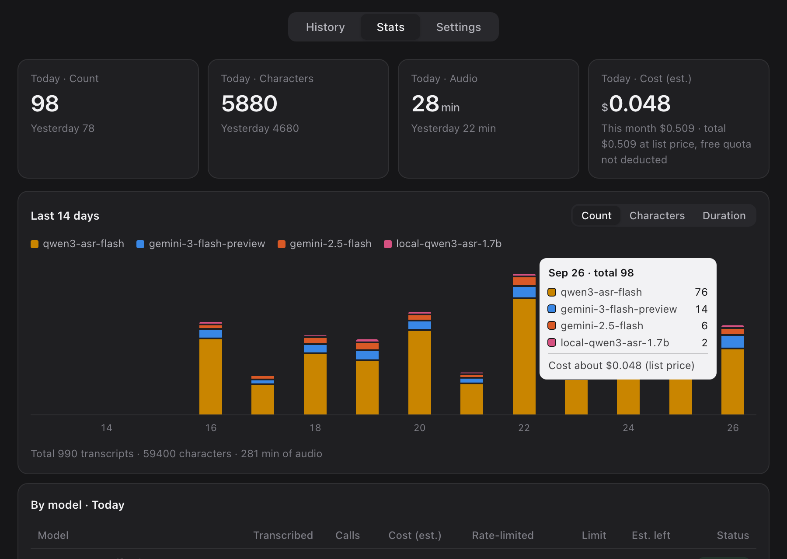

<h1 align="center">voice-input</h1>

<p align="center">
  <b>Tap a key on your Mac, speak, and the text lands at your cursor.</b><br>
  Push-to-talk dictation that writes down exactly what you said — no rewriting, no answering your prompt.
  Built for talking to Claude Code / ChatGPT, coding, and chat, in English, Chinese, or both mixed.
</p>

<p align="center">
  <a href="LICENSE"></a>
  
  
</p>

<p align="center">
  <b>English</b> · <a href="README.zh-CN.md">简体中文</a>
</p>

<p align="center">
  
</p>

## Why

I talk to AI coding agents most of the day, and typing is the bottleneck. Off-the-shelf
dictation got in the way in three ways: it misspells technical terms ("Cloud Code" for
"Claude Code"), some LLM-based tools "helpfully" rewrite what you said or even answer the
question you were dictating to the agent, and the good ones are monthly subscriptions. This one:

- **Transcribes with `qwen3-asr-flash`** (Alibaba Cloud Model Studio) — about one second per
  utterance, roughly **$0.13 per hour of audio** at list price on the International region.
  No Alibaba account? A free **Gemini** API key works on its own.
- **Proofreads with `qwen-plus` under a strict brief**: drop fillers and stutters, fix
  punctuation, normalize the spelling of terms — **never rewrite, never translate, never answer**.
  If the output length drifts, the proofread is discarded and the raw transcript is used.
- **Vocabulary list**: tell the model the names you use; `wrong => right` rules patch what
  it still gets wrong. A `vocab.local.txt` next to `vocab.txt` is read too, for words
  that should stay on this machine when `vocab.txt` lives in shared dotfiles.
- **Fallback chain**: Alibaba Cloud → Gemini (free tier) → an on-device model (works
  offline). Rate-limited, missing or unreachable models are skipped automatically.
- **English or Chinese UI**, following your macOS language (changeable in Settings).
  Mixed-language speech stays mixed.

## Using it

<p align="center"></p>

| Action | Result |
|---|---|
| **Hold right Command, speak, release** | Transcribed and pasted at the cursor (walkie-talkie mode) |
| **Tap right Command, speak, tap again** | Same, for longer passages |
| **Esc** while recording | Cancel (the audio is still kept, recoverable from the menu) |
| **⌃⌥V** | Picker over the last 40 transcripts; choose one to paste |
| Mouse **back button** to talk, **forward button** for Return, **middle click** to paste | Optional, enable in the menu |

- A small HUD at the bottom of the screen shows elapsed time and a live level meter, plus how
  many earlier clips are still being transcribed — you can keep talking while they finish.
- The text **always goes to the clipboard**; it is auto-pasted only if the cursor is still
  in the same input field, otherwise you get a "press ⌘V" hint.
- Saying just "compact" outputs `/compact`, and just "continue" outputs `continue` without a
  trailing period — handy for Claude Code.
- Newlines are stripped before pasting, because Claude Code collapses multi-line pastes
  into `[Pasted text]`.

Menu bar mic → **Open panel** to browse history (replay, re-transcribe, copy), see daily
usage and cost, per-model call stats, and edit keys, model order, microphone and vocabulary.

## Install

Requires macOS and [Homebrew](https://brew.sh).

```bash
brew install --cask hammerspoon
brew install ffmpeg jq
git clone https://github.com/siyuanseever/voice-input ~/projects/voice-input
~/projects/voice-input/install.sh
```

`install.sh` checks dependencies, copies the example vocabulary to
`~/.config/voice-input/vocab.txt`, and appends two lines to `~/.hammerspoon/init.lua`
that load this repo (your existing config is left alone). Then:

1. Open Hammerspoon and grant it **Accessibility** and **Microphone** in System Settings →
   Privacy & Security.
2. Get an API key — either one is enough, both give you a fallback:
   - [Gemini](https://aistudio.google.com/apikey): free tier, easiest to start with.
   - [Alibaba Cloud Model Studio](https://modelstudio.console.alibabacloud.com/) (International)
     or [阿里云百炼](https://bailian.console.aliyun.com/) (China): faster, and proofread by `qwen-plus`.
     Keys from the two regions are not interchangeable; with Region on Auto the tool finds out
     which one your key belongs to and remembers it.
3. Menu bar mic → Open Panel → Settings: paste the key and hit Test.
4. Tap right Command, say something, tap again.

<details>
<summary>Other ways to configure</summary>

- Keys can come from environment variables `DASHSCOPE_API_KEY` / `GEMINI_API_KEY`.
  Hammerspoon doesn't inherit your terminal environment, so put them in `~/.zshenv`
  (or `~/.secrets.zsh`, which is sourced if present).
- Gemini needs a proxy from mainland China — set `https_proxy` in `~/.zshenv`.
  Alibaba Cloud requests always go direct.
- Trigger key: menu → Set Trigger Key…; any single modifier works.
- Language and Alibaba Cloud region: panel → Settings, or `"language": "en"|"zh"` and
  `"region": "intl"|"cn"` in `config.json` (leave them out for Auto).
- Hide the Hammerspoon menu bar icon: run
  `hs.settings.set("voice.hideHammerspoonIcon", true)` in the console and reload.
- Settings live in `~/.config/voice-input/config.json`.

</details>

### Optional: on-device model

```bash
~/projects/voice-input/local-asr/setup.sh
```

Installs Qwen3-ASR-1.7B (4-bit MLX, Apple Silicon only, ~1.7 GB). It's only loaded when
every cloud model fails. On an M4 over 10 clips: ~1.7 s per clip, 2.5 GB peak memory,
noticeably less accurate than the cloud model — a last resort.

## Cost

Each response reports the billed audio seconds / tokens; the script multiplies by list
price (USD on the International region, CNY on the China region) and logs it to
`~/.local/state/voice-input/calls.jsonl`. The panel sums those.
**It is an estimate, not your bill** — new accounts get free quota, and the Alibaba Cloud
billing console has the real numbers. Gemini's free tier is logged as free.

## Privacy

- Audio is sent to whichever provider you configure (Alibaba Cloud / Google); the
  on-device model keeps it local.
- History and call logs stay in `~/.local/state/voice-input/`; only the last 10
  recordings are kept (configurable).
- Keys are stored in `~/.config/voice-input/config.json` with mode 600.

## Layout

```
bin/voice-input            recording (ffmpeg), model calls, proofreading, vocab rules — also a CLI
hammerspoon/voice.lua      hotkeys, HUD, menu, pasting
hammerspoon/voice_panel.lua + panel.html   the panel
local-asr/                 optional on-device model
tools/restart-hammerspoon  restart Hammerspoon after edits (refuses while recording)
```

With the English UI the prompts are language-neutral ("write what was spoken, never translate").
The Gemini path has no separate proofreading step, so it occasionally keeps a filler word.

## License

MIT
