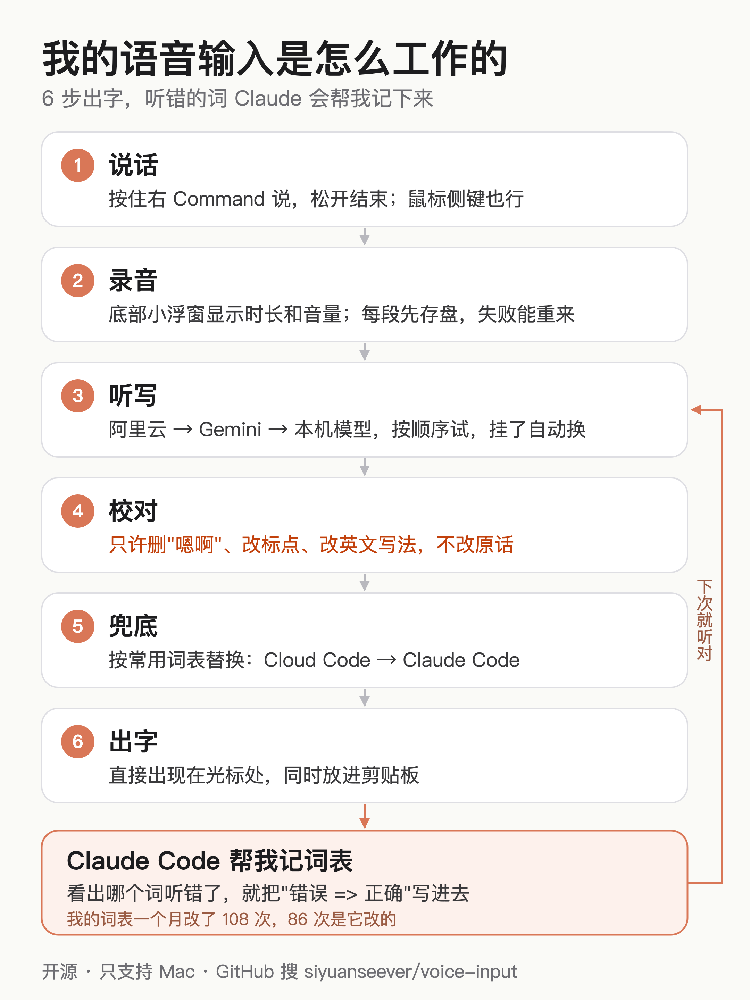
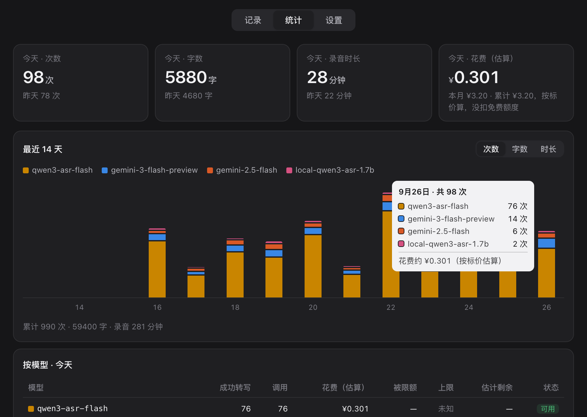

# 小红书草稿（未发布，等确认）

数据来源同 zhihu.md 顶部（2026-10-25 统计）。

## 标题（二选一，20 字以内）

- 一个月说了20万字，我快不用键盘了
- 自己做了个语音输入，一个月花了0元

## 正文

程序员一枚，最近几乎不打字了🎙️

每天和 AI 写代码、聊需求，打字太慢，就自己做了个 Mac 语音输入：
按一下键说话，说完文字直接出现在光标处。

用了一个月：转写 1872 段，录音 12.8 小时，约 20 万字。

为什么不用系统自带的听写？
我说话一半中文一半英文，普通语音识别经常把 "Claude Code" 写成 "Cloud Code"，改错比打字还累。

现在这套：
✅ 听写用阿里云的 qwen3-asr，国内直连，一句话一秒左右出结果
✅ 再让另一个模型校对：只许删"嗯啊"、改标点、把英文词写对，不许改我的原话
✅ 常用词表：自己常说的名字写进去，就不会再听错
✅ 阿里云连不上就自动换 Gemini，再不行用电脑本地的模型，断网也能用
✅ 鼠标侧键按住说话、另一个侧键回车，整个人靠在椅子上就能干活

花多少钱？
按标价算一个月约 11 块。实际 0 元：阿里云每个模型都有新人免费额度，
工具会先把免费的用完，用完自动停、不扣钱，才换下一个。
就算都用完了，一小时录音也才 8 毛。

代码开源在 GitHub，搜 siyuanseever/voice-input
（目前只支持 Mac）

## 标签

#程序员 #效率工具 #语音输入 #Mac #AI编程 #ClaudeCode #开源

## 配图（按顺序上传，第 1 张是封面）

小红书按 3:4 裁图，封面用竖版框架图；面板截图是横的，放后面。

1. 封面：`docs/promo/img/flow.xhs.png`（1080×1440 的 2 倍图）

   

2. `docs/promo/img/compare.zh.png`：校对前后对比（三句都是真实转写记录）

   

3. `docs/hud.png`：屏幕底部的录音浮窗 +「转写中 2」

   

4. `docs/panel.png`：面板统计页（虚构数据）

   
