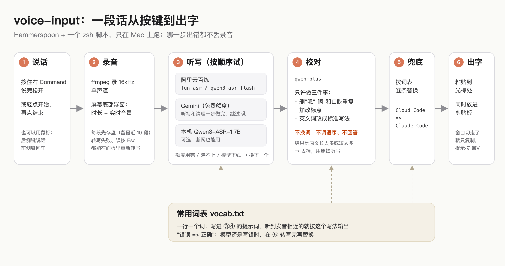
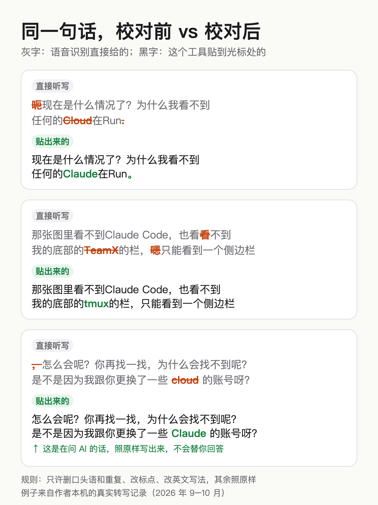
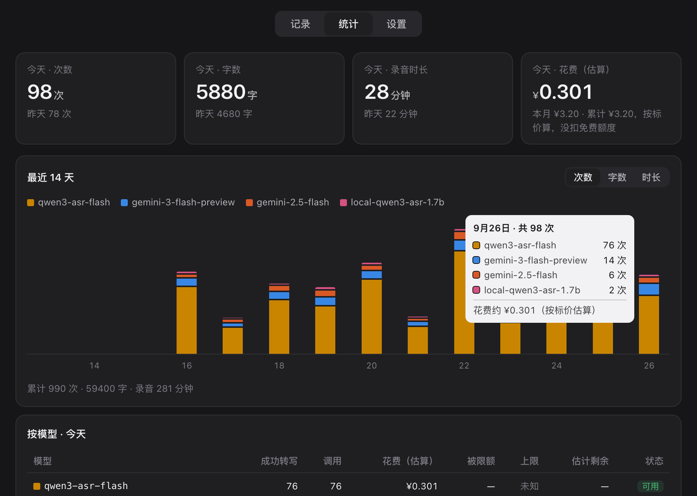

# 知乎稿

发布记录：
- 第一版：2026-09-26 22:13 发布，https://zhuanlan.zhihu.com/p/2087300758190535490 ，标题「我做了一个 Mac 语音输入，现在一天说 70 分钟话，几乎不碰键盘」，
  正文里一张浮窗图，题图是旧版面板截图，仓库地址还是 threedaycat/voice-input（GitHub 会跳转）。
- 第二版：2026-10-25 22:21 另发了一篇（p/2097812404444971888，标题「Mac Agent 语音输入工具」），和第一版重复，
  2026-10-27 用户已删除。
- 合并：2026-10-27 00:43 在第一版原链接上更新，标题改成下面的，正文同本文件（4 张图，面板图加注释「面板统计页（图中是虚构数据）」）。
  发布后逐字核对：正文与当时的本文件一致，只多了知乎给末尾链接自动补的 `http://`。题图没动，仍是旧版面板截图。
  线上这一版的正文见提交 c2ea2eb。
- 重写：2026-11-08 用户觉得旧稿「不是人话」、阅读量很低。先按口语重写（提交 aa609f1），用户又要求标题严肃、
  像论文或仓库名，正文改成技术博客写法，即下面的版本。未发布。

数据来源（2026-10-25 统计）：`~/.local/state/voice-input/history.jsonl`（1872 段，23 个使用日，2026-09-25 ~ 10-25）、
`calls.jsonl`（成功的听写调用合计 767 分钟，按标价估算 ¥11.26）、`billing.json`（阿里云账单里没有听写和校对模型的扣费）。
「两天时一天 167 段、录音 70 分钟」出自第一版原文。

## 标题

voice-input：基于语音识别与大模型校对的 macOS 中英混合语音输入工具

## 正文

> 本文初版写于 2026 年 9 月，当时刚用了两天。现在按一个月的使用数据重写。

### 背景

我现在大部分编程工作是在和 Claude Code 这类编程智能体对话：描述需求，指出问题，让它修改。这类输入量大、口语化，中文里还夹着大量英文技术词。打字成了瓶颈，所以我写了 voice-input，一个 macOS 上的语音输入工具。

一个月（2026-09-25 至 10-25，23 个使用日）的数据：转写 1872 段，录音约 12.8 小时，产出约 20 万字。按阿里云标价折算约 11 元，实际账单为 0，因为新用户免费额度还没用完。

代码已开源：github.com/siyuanseever/voice-input

### 问题：现成的语音输入为什么不够用

在这个场景下，现成方案有三个问题：

1. **英文术语识别错误。** 我实际遇到过 Claude Code 被写成 Cloud Code，Codex 被写成 Codecs。
2. **过度改写。** 用大模型做后处理的工具，容易把口语"润色"掉。我的输入是给智能体的指令，措辞一变，意思就可能跑偏。
3. **订阅制，服务器在海外。**

所以目标很明确：逐字转写，只做最小修正；英文术语要写对；成本低，国内能直连。

### 整体设计



一次输入分 6 步：按键、录音、听写、校对、词表替换、粘贴。

交互上，按一下右 Command 开始，再按一下结束，也支持按住说、松开结束。结束后一两秒出字：文字粘贴到光标处，同时放进剪贴板。上一段还没转写完，可以接着录下一段。


鼠标侧键也做了映射：按住后退键说话，前进键回车，中键粘贴。

### 听写

听写用阿里云百炼的 `qwen3-asr-flash`，国内直连，标价约 0.8 元/小时录音。免费额度没用完时，先用同一套接口的 `fun-asr-flash`。

### 受限校对

听写结果交给 `qwen-plus` 校对。提示词只允许三类修改：

- 删除语气词（嗯、啊）和口吃重复；
- 修正标点；
- 把英文术语改成标准写法。

同义替换、调整语序、补全句子，一律不允许。

下面是三条真实转写记录。灰色是语音识别的原始输出，黑色是最终结果：



这里有两条经验：

- **模型选型比提示词更重要。** 最初用更便宜的 `qwen-flash`，它会把"跟我说"改成"跟我讲"，还会补出半句话。规则写得越严，效果反而越差。换成 `qwen-plus` 后，这个问题就没有了。
- **加一道长度校验。** 校对结果和原文的长度差太多时，判定为越界，退回原始听写。

### 词表

词表是一个纯文本文件，支持两种条目：

```
Claude Code                  ← 写入提示词：发音相近时按此写法输出
Cloud Code => Claude Code    ← 转写后替换：模型仍写错时兜底
```

有一个反例值得记下来。我曾在提示词里写过一个示例："听起来像 cloud code 的其实是 Claude Code"。结果模型开始在我没提到的地方插入 "Claude"。提示词里的示例会被模型当成"这段话里有这个词"。从那以后，我只给词表，不给示例。

#### 由 Claude Code 维护词表

我的输入几乎都经过这个工具，而接收方 Claude Code 能从上下文判断哪个词被听错了。所以我在全局 `CLAUDE.md` 里加了一条规则：发现听错的词，并且能确定原词，就把 `错误 => 正确` 写进词表，并在回复末尾说明。

一个月里词表改了 108 次，其中 86 次是 Claude 提交的。比如我说"这些亚子这些东西"，它判断出是 yazi（一个终端文件管理器），就加了 `亚子 => yazi`，之后同样的发音就能转写正确。这样就形成了一个闭环：转写出错，智能体发现，写进词表，下次转写正确。架构图右下角画的就是这个闭环。

规则原文如下，词表路径按自己的改：

```
## 语音输入听错的词：看出来就记进词表
我用语音输入，消息里常有听错的专有名词。你读懂了意思、并且能确定原词时，
把「错误 => 正确」加进 ~/.config/voice-input/vocab.txt，回复末尾用一行说加了什么。
错误写法是常用词就带上前后文（「form 会话 => phone 会话」，不是「form => phone」）；猜不准就先问我。
```

### 成本

百炼给每个模型版本单独提供一份新用户免费额度：`fun-asr-flash` 10 小时，`qwen-plus` 两个版本各 100 万 token。工具按顺序调用，先用完免费额度，再切到按量付费的主模型。（原来还有两个 `qwen3-asr-flash` 日期版本各 10 小时，10 月 13 日起返回"模型不存在"，工具会自动跳过。）

前提是在百炼控制台给这些版本打开「用完即停」。额度用完后，接口返回 403，不会扣费，工具据此切换到下一个。



### 降级链路

阿里云限流或不可用时，切换到 Gemini（免费额度）；再失败，就用本机的 Qwen3-ASR-1.7B（MLX 4-bit 版）。本机模型我测了 10 段录音：单段约 1.7 秒，峰值内存 2.5 GB，但有 5 处识别错误，所以只作最后的兜底。

### 和 Claude Code 配合的细节

- Claude Code 会把多行粘贴折叠成 `[Pasted text]`，看不到内容，所以粘贴前会去掉换行。
- 整段只说 "compact" 时，输出 `/compact`；只说"继续"时，输出"继续"，不加句号。

### 实现与局限

实现上是 Hammerspoon 加一个 zsh 脚本，两千多行，只支持 macOS。菜单里的面板可以看转写记录、重听录音、看每天的用量和费用。

目前的局限：

- 依赖云端 API。离线时只能用准确率低得多的本机模型。
- 0 元靠的是新用户免费额度，用完之后约 0.8 元/小时。
- 只在我自己的口音和用词上验证过。

仓库地址：github.com/siyuanseever/voice-input

## 发文时要上传的图（按出现顺序）

1. `docs/promo/img/architecture.zh.png`：框架图（SVG 源文件同名，改了用 `docs/promo/img/render.py` 重新出图）
2. `docs/hud.png`：录音浮窗
3. `docs/promo/img/compare.zh.png`：校对前后对比（三句都是真实记录）
4. `docs/panel.png`：面板统计页（虚构数据，发布时加图注「面板统计页（图中是虚构数据）」）

话题沿用第一版：Mac、语音识别、效率工具。
